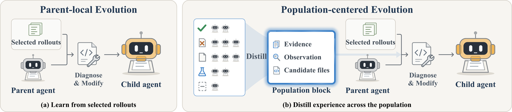

<h1 align="center">
    The View from Nowhere:<br/>Population-Centered Agent Evolution
</h1>

Repository for **Population-Centered Evolution (PCE)**, which distils population-wide experience into a
population block that guides improvements to a selected parent's harness.

<p align="center">
  
</p>

## Setup

Requires Linux with Docker, Conda or Miniforge, a DeepSeek API key, and at least 500 GB of free disk
(1 TB recommended).

```bash
# API key: create secrets.env in the repository root with
# DEEPSEEK_API_KEY=...
```

```bash
# Verify that Docker is properly configured in your environment.
docker run hello-world

# If a permission error occurs, add the user to the Docker group
sudo usermod -aG docker $USER
newgrp docker
```

```bash
# Install dependencies (Python 3.11)
conda env create -f environment.yml
conda activate mini_oracle
```

```bash
# Clone SWE-bench, apply the patches, and install it from this tree (not from PyPI)
cd swe_bench
git clone https://github.com/princeton-nlp/SWE-bench.git
cd SWE-bench
git checkout dc4c087c2b9e4cefebf2e3d201d27e362d899e0f
git apply ../../patches/0001-swebench-roman.patch
git apply ../../patches/0003-swebench-docutils-sphinx30.patch
git apply ../../patches/0004-swebench-list-images.patch
pip install -e .
cd ../../

# Prepare Polyglot and build its images
# Make sure git is configured with a user.name and a user.email
# Re-run rebuild_images.sh whenever prepare_polyglot_dataset is re-run
python -m polyglot.prepare_polyglot_dataset
bash polyglot/rebuild_images.sh
```

## Running the experiments

```bash
# SWE-bench: GEA baseline and PCE
./run_swe.sh gea
./run_swe.sh distill

# Polyglot: GEA baseline and PCE
./run_polyglot.sh polyglot_gea
./run_polyglot.sh polyglot_distill
```

A SWE-bench run takes about four days and a Polyglot run about one day, depending on the number of
evaluation workers. Runs stay in the foreground, so start them in `tmux` or `screen`. Add `--rebuild`
after changing the code, and `--continue-from output_dgm/<run>` to resume a run. Results are written to
`output_dgm/<run>/`.

## Acknowledgement

This codebase is built upon [GEA](https://github.com/UCSB-AI/GEA), which is built upon the
[Darwin Gödel Machine (DGM)](https://github.com/jennyzzt/dgm). We sincerely thank the authors for
their inspiring and impactful work.

The evaluation is based on the [SWE-bench](https://github.com/princeton-nlp/SWE-bench) and
[polyglot-benchmark](https://github.com/Aider-AI/polyglot-benchmark) repositories.

## License

Apache License 2.0. See [`LICENSE`](LICENSE).
